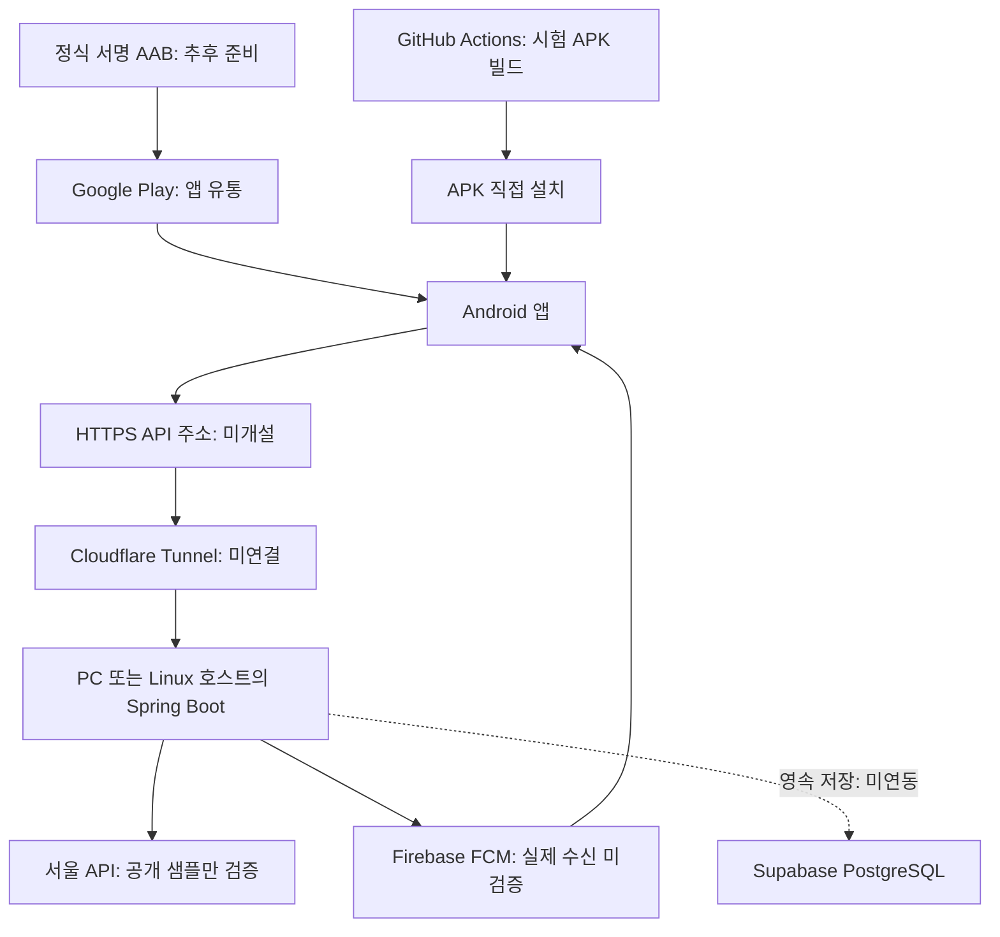

# 지하철 하차 알림 (subway_alert)

출발역과 목적지를 선택하면 목적지 한 정거장 전에 Android 백그라운드 알림을 제공하는 앱을 개발합니다. 즐겨찾기 최대 5개, 출퇴근 조건 감지, 역 편의시설 안내가 최종 목표입니다.

**현재 TEST 전용 개발 버전입니다.** 공개 샘플 조회와 시험 감시·FCM 코드까지 구현했으나, 실제 하차 추적은 차단했습니다. 실제 Firebase·서울 API 키·휴대폰 수신은 검증되지 않았으므로 하차 판단에 의존하지 마세요.

## 서버·터널·앱 배포의 역할과 결정 상태

| 구성 | 역할 | 개발·운영 기준 | 실제 상태 |
| --- | --- | --- | --- |
| 개발 백엔드 호스트 | Spring Boot API·폴링·FCM 실행 | 개인 PC의 Docker 컨테이너 | 로컬 Java 실행 검증, Docker 구성 추가 |
| Cloudflare Tunnel | 실행 중인 API를 HTTPS 주소로 연결 | 개발 기기 검증용 연결 수단 | 계정·도메인·터널 미구성, 템플릿만 작성 |
| 운영 백엔드 호스트 | API·스케줄러 24시간 실행 | 상시 실행 Linux 서버 + Docker | VPS 업체·리전·요금 미선정, 서버 미생성 |
| Supabase | 향후 PostgreSQL 영속 저장 | 운영 데이터 저장 목표 | 이 앱에 연결할 프로젝트 미확정, 스키마 초안 미적용 |
| Firebase FCM | Android 원격 푸시 전달 | 시험 알림 전송 코드 구현 | 실제 자격 증명·기기 수신 미검증 |
| GitHub Actions | 테스트·Android 설치 파일 생성 | 시험 APK를 Artifact로 제공 | 워크플로 작성, 원격 실행 결과 미확인 |
| Google Play | 앱 설치·업데이트 유통 | Android 정식 배포처 | 계정·앱 등록·심사 미진행 |
| APK 직접 설치 | 소수 개발자의 기기 시험 | 정식 출시 전 내부 시험 | 독립 ARM64 시험 APK 빌드·서명 검사 완료 |

**Cloudflare Tunnel은 백엔드 호스팅이 아닙니다.** PC나 서버에서 Spring Boot가 계속 실행되어야 합니다. PC가 꺼지거나 절전 상태가 되면 API와 폴링도 중지됩니다. Supabase 역시 현재 Spring Boot를 대신 실행하지 않습니다.

**Android 앱에는 별도 웹용 ‘앱 배포 서버’가 필요하지 않습니다.** 설치 파일은 CI에서 만들고 시험에는 APK를 전달하며, 정식 출시는 서명된 AAB를 Google Play Console에 제출합니다. EAS Build는 선택 가능한 대체 빌드 서비스이며 현재 필수 구성은 아닙니다. 앱이 사용하는 API 서버는 별도로 운영합니다.



## 현재 구현 범위

- 앱: 일부 2호선 5개 역 검색·경로 선택, 즐겨찾기 최대 5개, 위치 기반 로컬 데모 감시, 출퇴근 확인 알림.
- 열차 조회: 서버를 통한 서울 공개 sample 응답 최대 5건, 번호·방향·시각 표시와 선택.
- 시험 감시: TEST 세션 등록·조회·취소, 공유 샘플 폴링, FCM 시험 요청과 상태 표시. FCM_ACCEPTED는 휴대폰 수신 확인이 아닙니다.
- 보호 장치: LIVE 감시 차단, 오래된 정보·다른 열차 제외, 시험 전용 문구, 짧은 FCM 만료시간.
- 미완료: 실제 경로·방향·시간대 검증, 실키 HTTPS, Firebase 기기 수신, 전체 역·시설, DB 영속 저장·사용자 인증·운영 쿼터·복구.

## 로컬에서 시작하기

소스 실행은 JDK 17·Maven, 앱 개발은 Node.js·npm과 Android SDK가 필요합니다. 컨테이너 실행은 Docker Compose가 설치된 PC에서 수행합니다.

```sh
# 저장소 루트: 로컬 전용 백엔드 구성 확인·실행
docker compose config
docker compose up --build -d
curl http://127.0.0.1:8080/api/health
docker compose down
```

기본 구성은 호스트의 127.0.0.1:8080에만 포트를 엽니다. [배포 실행 안내](docs/deployment.md)에서 환경변수·실행·중지 절차를 확인하세요. **현재 API를 그대로 공개 터널에 연결하지 마세요.** 사용자 인증·요청 제한·기기 접근 정책을 먼저 구현·검증해야 합니다. 세션 소유 토큰만으로 인터넷 공개용 보안이 완성되지는 않습니다.

```sh
# Docker 없이 서버 테스트·실행
cd server
mvn test
mvn spring-boot:run
```

```sh
# 앱 테스트·개발 빌드
cd mobile
npm ci
npm test
npx expo run:android
```

앱은 사용자가 지정한 HTTPS 서버에 연결합니다. Metro 개발 모드의 로컬 HTTP 예외는 [모바일 안내](mobile/README.md)를 참고하세요. Firebase 설정이 없는 시험 APK에서는 원격 FCM 토큰을 발급받을 수 없습니다.

## Android 빌드와 정식 출시

| 단계 | 경로 | 의미 |
| --- | --- | --- |
| 개발 실행 | npx expo run:android | Metro 연결이 필요한 개발 환경 |
| 독립 시험 APK | CI의 Standalone Android test APK (ARM64, debug signed) 작업 | JS 내장·ARM64·Debug 키 서명·Artifact 14일 보관 |
| 정식 출시 | 정식 업로드 키로 서명한 AAB → Play Console | 계정·Firebase 설정·스토어 자료·정책 심사·실기기 검증 필요 |

CI는 Play에 자동 게시하지 않습니다. 릴리스 변형으로 빌드하더라도 현재 Debug 키로 서명한 APK는 정식 출시 파일이 아닙니다. 기본 main에는 초기 파일만 있으므로 현재 코드는 개발 브랜치와 변경 요청에서 확인해야 합니다.

## 필요한 계정과 비밀 설정

| 필요한 항목 | 설정 위치 | 상태 |
| --- | --- | --- |
| Firebase Android google-services.json | 빌드 PC 파일과 GOOGLE_SERVICES_JSON 경로 | 미제공, 포함해 네이티브 재빌드 필요 |
| Firebase 프로젝트 ID·서버 ADC | 백엔드 비밀 설정, FCM_ENABLED 기본 false | 실제 전송 미검증 |
| 서울 실시간 API 키 | 서버 SEOUL_SUBWAY_KEY | 샘플만 검증, 실키 HTTPS 미검증 |
| Cloudflare 계정·도메인·터널 자격 증명 | 운영자 PC/서버 비밀 저장소 | 미구성 |
| Google Play 계정·업로드 키 | Play Console·보호된 빌드 비밀 | 미구성 |
| Supabase 프로젝트·DB 연결 정보 | 백엔드 환경 설정 | 미확정·미연동 |

서버 서비스 계정 키·서울 키·터널 자격 증명·정식 서명 키를 저장소나 앱에 넣지 않습니다. 무료 플랜이 있더라도 호스트·도메인·전기·상시 가동·사용량 비용까지 무료라고 보장하지 않습니다.

## 문서·검증·다음 작업

- [설계·아키텍처 v1.1](docs/architecture.md): 현재 구현과 목표, 기존 설계 변경점.
- [배포 실행 안내](docs/deployment.md), [서버 API와 FCM](server/README.md), [Android 앱](mobile/README.md), [Supabase 초안](supabase/README.md).
- 앞선 검증: 서버 33개·모바일 21개 테스트 통과. 독립 ARM64 시험 APK 빌드·서명·JS 포함 검사 완료. 실제 기기 수신 미검증.
- [이번 배포 구성의 검증 기록](docs/verification-deployment.md): Docker 실행·터널 연결·Play 게시까지 완료한 상태는 아닙니다.

다음 순서는 개발 PC의 Docker 실행 재현 → Firebase 설정 후 앱 재빌드 → API 인증·호출 제한 → 개발용 HTTPS 터널 → 실키·경로·시간·기기 검증 → DB·재시작 복구 → VPS 업체·예산 확정 → Google Play 출시입니다.
