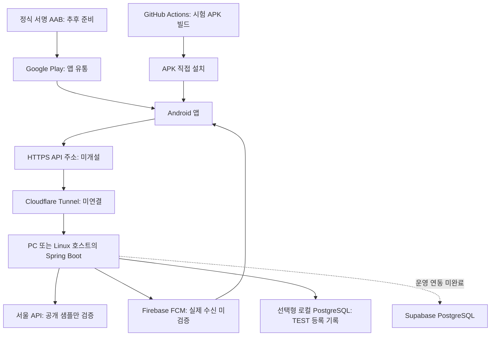

# 지하철 하차 알림 (subway_alert)

출발역과 목적지를 선택하면 목적지 한 정거장 전에 Android 백그라운드 알림을 제공하는 앱을 개발합니다. 즐겨찾기 최대 5개, 출퇴근 조건 감지, 역 편의시설 안내가 최종 목표입니다.

**현재 TEST 전용 개발 버전입니다.** 공개 샘플 조회와 시험 감시·FCM 코드까지 구현했으나, 실제 하차 추적은 차단했습니다. 실제 Firebase·서울 API 키·휴대폰 수신은 검증되지 않았으므로 하차 판단에 의존하지 마세요.

## 서버·터널·앱 배포의 역할과 결정 상태

| 구성 | 역할 | 개발·운영 기준 | 실제 상태 |
| --- | --- | --- | --- |
| 개발 백엔드 호스트 | Spring Boot API·폴링·FCM 실행 | 개인 PC의 Docker 컨테이너 | CI #20의 실제 이미지·기동·인증·재시작·정리 통과, 개발 PC 재현 미실시 |
| Cloudflare Tunnel | 실행 중인 API를 HTTPS 주소로 연결 | 개발 기기 검증용 연결 수단 | 계정·도메인·터널 미구성, 템플릿만 작성 |
| 운영 백엔드 호스트 | API·스케줄러 24시간 실행 | 상시 실행 Linux 서버 + Docker | VPS 업체·리전·요금 미선정, 서버 미생성 |
| PostgreSQL / Supabase | TEST 등록 기록 저장 / 향후 운영 DB | 선택형 로컬 PostgreSQL, 클라우드는 Supabase 목표 | 로컬 저장 구현, Supabase 프로젝트 미확정·미적용 |
| Firebase FCM | Android 원격 푸시 전달 | 시험 알림 전송 코드 구현 | 실제 자격 증명·기기 수신 미검증 |
| GitHub Actions | 테스트·Android 설치 파일 생성 | 시험 APK를 Artifact로 제공 | CI #17의 시험 APK 성공, CI #20의 Docker 작업 성공 |
| Google Play | 앱 설치·업데이트 유통 | Android 정식 배포처 | 계정·앱 등록·심사 미진행 |
| APK 직접 설치 | 소수 개발자의 기기 시험 | 정식 출시 전 내부 시험 | 독립 ARM64 시험 APK 빌드·서명 검사 완료 |

**Cloudflare Tunnel은 백엔드 호스팅이 아닙니다.** PC나 서버에서 Spring Boot가 계속 실행되어야 합니다. PC가 꺼지거나 절전 상태가 되면 API와 폴링도 중지됩니다. Supabase 역시 현재 Spring Boot를 대신 실행하지 않습니다.

**Android 앱에는 별도 웹용 ‘앱 배포 서버’가 필요하지 않습니다.** 설치 파일은 CI에서 만들고 시험에는 APK를 전달하며, 정식 출시는 서명된 AAB를 Google Play Console에 제출합니다. EAS Build는 선택 가능한 대체 빌드 서비스이며 현재 필수 구성은 아닙니다. 앱이 사용하는 API 서버는 별도로 운영합니다.



## 현재 구현 범위

- 앱: 일부 2호선 5개 역 검색·경로 선택, 즐겨찾기 최대 5개, 요일·시간 수정, 위치 기반 로컬 데모 감시와 출퇴근 확인 알림.
- 열차 조회: 서버를 통한 서울 공개 sample 응답 최대 5건, 번호·방향·시각 표시와 선택.
- 시험 감시: TEST 세션 등록·조회·취소, 공유 샘플 폴링, FCM 시험 요청과 상태 표시. FCM_ACCEPTED는 휴대폰 수신 확인이 아닙니다.
- 보호 장치: 개발 기기별 Bearer 키, 전체·키별·등록·직접 조회 호출 제한, LIVE 감시 차단, 오래된 정보·다른 열차 제외, 시험 전용 문구, 짧은 FCM 만료시간.
- 등록 복구: 선택형 PostgreSQL에 등록·취소 기록과 해시를 저장합니다. 서버 재시작 시 기록을 복원하고 진행 중 감시는 종료합니다. 기본 메모리 모드는 재시작하면 기록이 사라집니다.
- 미완료: 실제 경로·방향·시간대 검증, 실키 HTTPS, Firebase 기기 수신, 전체 역·시설, Supabase 운영 연결·사용자 인증·분산 쿼터·운영 복구.

## 로컬에서 시작하기

소스 실행은 JDK 17·Maven, 앱 개발은 Node.js·npm과 Android SDK가 필요합니다. 컨테이너 실행은 Docker Engine 28 이상과 `up --wait`를 지원하는 Docker Compose v2 이상이 설치된 PC에서 수행합니다.

```sh
# 저장소 루트: 기존 파일을 덮어쓰지 않고 비공개 시험 키 생성
python3 deploy/generate_api_tokens.py --output .env
docker compose --env-file .env config --quiet
docker compose --env-file .env up --build --wait --wait-timeout 180
curl http://127.0.0.1:8080/api/health
docker compose down
```

재시작 후에도 TEST 등록 기록을 유지하려면 [PostgreSQL 저장 안내](docs/durable-receipts.md)의 별도 Compose 구성을 사용합니다. 외부 API 키나 Supabase 계정 없이 실행할 수 있으며 DB 비밀번호는 생성 도구가 만듭니다. FCM·서울 API 실제 키를 연결하는 설정과는 별개입니다.

기본 구성은 호스트의 127.0.0.1:8080에만 포트를 엽니다. [배포 실행 안내](docs/deployment.md)에서 환경변수·실행·중지 절차를 확인하세요. 키를 설정하지 않으면 정확히 `GET /api/health` 외에는 503, 설정 후 키가 없거나 잘못되면 401, 호출 예산을 넘으면 429와 `Retry-After`를 반환합니다. localhost와 프록시 요청도 인증이 필요합니다. 세션 조회·취소에는 Bearer 키와 기존 `X-Session-Token`이 모두 필요합니다.

별도 실행 검증은 POSIX 환경의 저장소 루트에서 다음 명령으로 수행합니다. 기존 `.env`나 기본 Compose 프로젝트·이미지 대신 임시 키·루프백 포트·고유 프로젝트·이미지를 사용하며, 검사 뒤 자신이 만든 프로젝트만 정리합니다. 실제 Docker 실행 결과와 검사 범위는 [Docker 검증 기록](docs/verification-docker.md)에 남깁니다.

```sh
python3 deploy/smoke_compose.py --report artifacts/docker-smoke.json
```

이 보호는 신뢰한 소수 시험 참가자를 위한 사전 공유 키이며 일반 사용자 로그인은 아닙니다. 앱에 공용 비밀을 내장하지 않습니다. **공개 Tunnel은 여전히 비활성 상태입니다.** 실제 HTTPS·자격 증명·기기 접속 검증과 운영 보안 조건이 갖춰진 뒤 별도로 연결해야 합니다.

```sh
# Docker 없이 서버 테스트·실행: 위에서 생성한 .env 사용
mvn -f server/pom.xml test
set -a
. ./.env
set +a
mvn -f server/pom.xml spring-boot:run
```

```sh
# 앱 테스트·개발 빌드
cd mobile
npm ci
npm test
npx expo run:android
```

앱의 서버 연결 화면에 HTTPS origin과 운영자가 전달한 기기 키를 입력합니다. 연결 정보는 SecureStore에 저장하며 주소 변경 시 키를 비웁니다. 기존 감시의 취소는 등록 당시 origin과 키를 사용합니다. Metro 개발 모드의 로컬 HTTP 예외는 [모바일 안내](mobile/README.md)를 참고하세요. Firebase 설정이 없는 시험 APK에서는 원격 FCM 토큰을 발급받을 수 없습니다.

## Android 빌드와 정식 출시

| 단계 | 경로 | 의미 |
| --- | --- | --- |
| 개발 실행 | npx expo run:android | Metro 연결이 필요한 개발 환경 |
| 독립 시험 APK | CI의 Standalone Android test APK (ARM64, debug signed) 작업 | JS 내장·ARM64·Debug 키 서명·Artifact 14일 보관 |
| 정식 출시 | 정식 업로드 키로 서명한 AAB → Play Console | 계정·Firebase 설정·스토어 자료·정책 심사·실기기 검증 필요 |

CI는 Play에 자동 게시하지 않습니다. 릴리스 변형으로 빌드하더라도 현재 Debug 키로 서명한 APK는 정식 출시 파일이 아닙니다. [접근 보호 CI #17 검증 결과](https://github.com/yuilyoung/subway_alert/actions/runs/40525199870)에서 기존 3개 작업과 시험 APK 생성이 성공했습니다. 이 실행에는 새 Docker 작업이 포함되지 않았고, 실제 Android 설치·FCM 수신은 검증하지 않았습니다.

## 필요한 계정과 비밀 설정

| 필요한 항목 | 설정 위치 | 상태 |
| --- | --- | --- |
| 시험 참가자별 API 키 | 서버 SUBWAY_API_TOKENS와 기기 SecureStore | 생성 도구 제공, 운영자가 별도 전달·회수 |
| Firebase Android google-services.json | 빌드 PC 파일과 GOOGLE_SERVICES_JSON 경로 | 미제공, 포함해 네이티브 재빌드 필요 |
| Firebase 프로젝트 ID·서버 ADC | 백엔드 비밀 설정, FCM_ENABLED 기본 false | 실제 전송 미검증 |
| 서울 실시간 API 키 | 서버 SEOUL_SUBWAY_KEY | 샘플만 검증, 실키 HTTPS 미검증 |
| Cloudflare 계정·도메인·터널 자격 증명 | 운영자 PC/서버 비밀 저장소 | 미구성 |
| Google Play 계정·업로드 키 | Play Console·보호된 빌드 비밀 | 미구성 |
| 로컬 PostgreSQL 비밀번호 | --postgres 생성 도구 → 백엔드 환경 설정 | 외부 계정 없이 선택형 저장 시험 |
| Supabase 프로젝트·DB 연결 정보 | 백엔드 환경 설정 | 운영 프로젝트 미확정·미연동 |

서버 서비스 계정 키·서울 키·터널 자격 증명·정식 서명 키를 저장소나 앱에 넣지 않습니다. 무료 플랜이 있더라도 호스트·도메인·전기·상시 가동·사용량 비용까지 무료라고 보장하지 않습니다.

## 문서·검증·다음 작업

- [설계·아키텍처 v1.3](docs/architecture.md): 현재 구현과 목표, 개발 접근 보호와 운영 미완료 항목. 별도 PDF v1.1에는 이번 개정이 아직 반영되지 않았습니다.
- [배포 실행 안내](docs/deployment.md), [서버 API와 FCM](server/README.md), [Android 앱](mobile/README.md), [Supabase 초안](supabase/README.md).
- 접근 보호 검증: 서버 52개·모바일 35개·Python 12개 테스트와 실행 JAR 인증·호출 제한 검사, CI #17의 독립 ARM64 시험 APK 생성 성공. 실제 기기 설치·FCM 수신은 미검증입니다.
- [접근 보호·배포 구성 기록](docs/verification-deployment.md), [Docker 실행 검증 기록](docs/verification-docker.md): 로컬 가짜 응답 테스트와 실제 Docker CI를 구분하며, CI #20의 Docker 작업과 안전한 보고서 성공을 확인했습니다. Tunnel 연결·Play 게시 완료를 뜻하지 않습니다.

호출 예산은 단일 프로세스 기준 전체 600회/분, 기기 키별 60회/분, 세션 생성 키별 3회/분입니다. 직접 열차 조회는 모든 키 합계 6회/분·서울 날짜 하루 240회이고 시험 감시 공유 폴링의 하루 600회와 별도여서 sample 모드에서 합계 최대 840회/일입니다. 재시작·복제하면 예산이 초기화·증가하므로 운영 과금 제어는 아닙니다.

직접 조회 240회는 클라이언트 요청의 허용 횟수입니다. 실키 LIVE 조회 한 번은 최대 5페이지의 서울 API 호출을 수행할 수 있어 외부 호출 840회 상한은 sample 모드에만 해당합니다. 실키의 통합 외부 호출 예산은 후속 구현이 필요합니다.

다음 순서는 개발 PC의 선택형 DB 실행 재현 → Firebase 설정 후 앱 재빌드 → 인증된 개발용 HTTPS 터널 → 실키·경로·시간·기기 검증 → Supabase 운영 DB·백업·모니터링 준비 → VPS 업체·예산 확정 → Google Play 출시입니다.

감시 등록은 ID·세션 비밀을 기기에 먼저 보관해 응답 유실 뒤 같은 요청을 조회·재시도·종료하도록 구현합니다. 오래된 관측의 재등록과 앱 복원 시 자동 POST는 차단합니다. PostgreSQL 모드는 기록을 보존하고 같은 DB에 두 번째 백엔드를 실행하지 못하게 합니다. 진행 중 감시의 자동 재개나 분산 실행을 제공하지 않습니다. [등록 응답 유실과 복구](docs/registration-recovery.md), [DB 저장과 재시작](docs/durable-receipts.md)을 참고하세요.

선택형 DB 저장 변경의 실제 로컬 검사와 CI 범위는 [영속 저장 검증 기록](docs/verification-durability.md)에 구분합니다.

즐겨찾기는 월~일 중 원하는 요일과 시간대를 지정하고 기존 항목의 **요일·시간 수정**으로 편집합니다. 일요일 23:00–01:00처럼 자정을 넘으면 시작 요일 기준이며 같은 시간대의 제안을 자정 전후로 중복 요청하지 않습니다. 저장 전 초안은 기존 감지 조건에 반영되지 않습니다. [출퇴근 조건 사용법과 검증 범위](docs/commute-schedules.md)를 참고하세요. 외부 API 키 없이 사용하는 로컬 데모 기능이며 실제 자동 탑승·하차 판정은 아닙니다.
